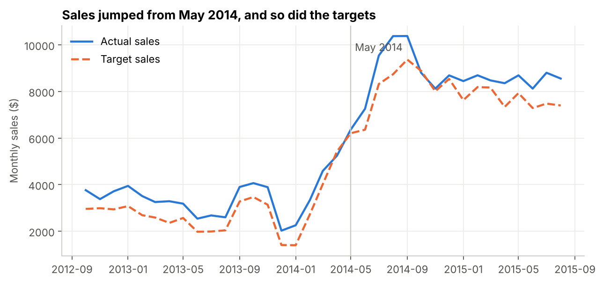
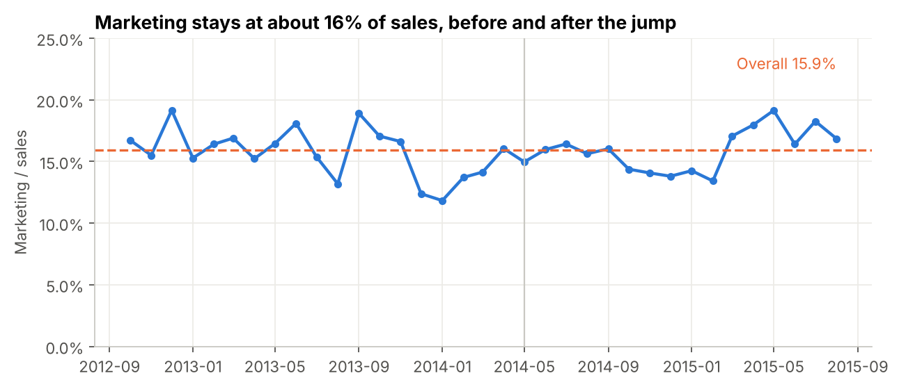
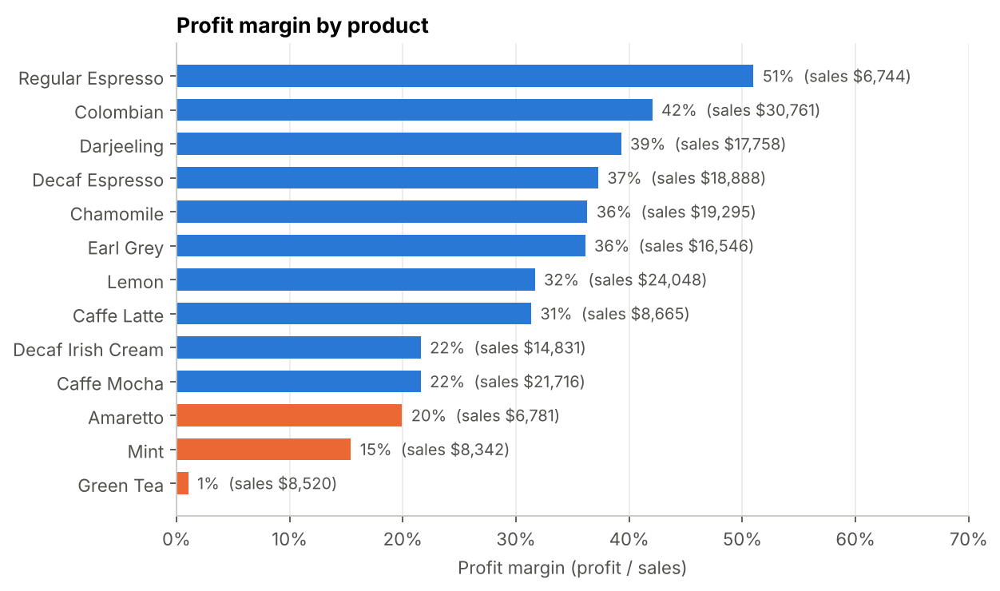
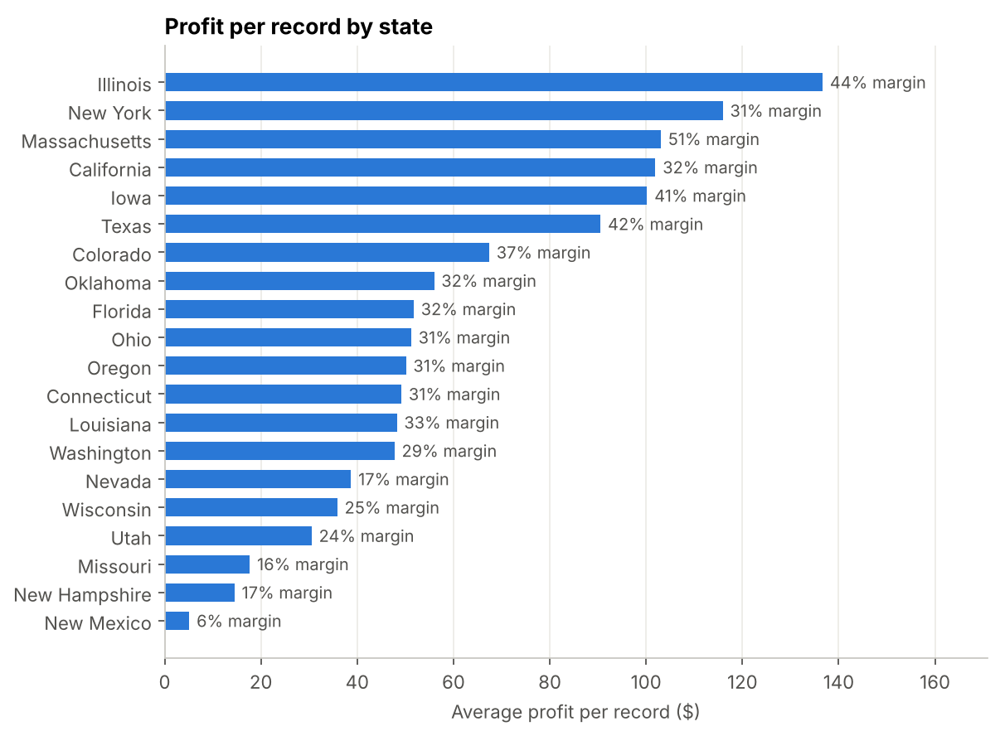
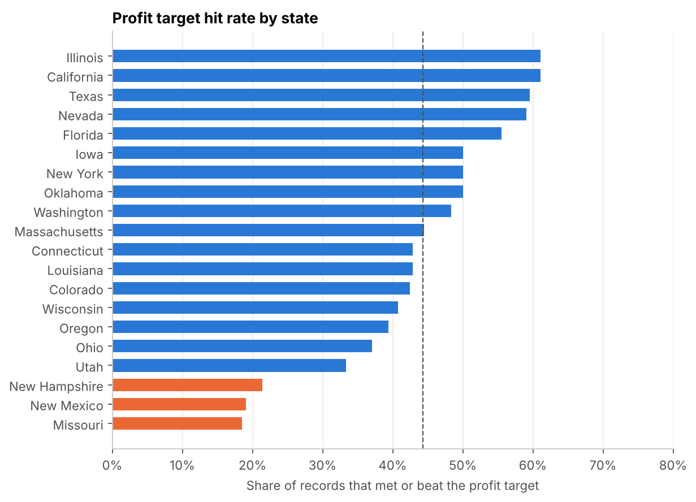

# Coffee Chain Sales Analysis

Exploratory analysis of a coffee chain's sales, marketing, profit and targets across 13 products and 20 US states, from October 2012 to August 2015.

This is a revised version of a 2024 team project. The revision rechecks the original conclusions, and one of them turned out to be wrong: see [What I got wrong the first time](#what-i-got-wrong-the-first-time).

## Questions

1. What drove the jump in sales from May 2014?
2. Which products and states are really the most profitable once the size of each group is taken into account?
3. Where does the chain miss its profit targets?

## Key findings

| # | Finding | Number |
|---|---|---|
| 1 | The May 2014 sales jump was planned, not a surprise | Sales per record +152%, and sales targets per record +183% |
| 2 | Marketing follows sales, so the data cannot show that marketing drives them | Marketing is 15.9% of sales both before and after the jump |
| 3 | One product earns almost nothing | Green Tea: $8,520 in sales, 1% profit margin |
| 4 | The most profitable state depends on how you measure | California leads on total sales; Illinois leads on profit per record ($137 vs $102) and margin (44% vs 32%) |
| 5 | Three states combine low profit with missed targets | Missouri, New Mexico and New Hampshire: 6% to 17% margin, about 20% target hit rate |



## What I got wrong the first time

The original version found a 0.97 correlation between monthly marketing spend and monthly sales, and concluded that marketing drives sales growth.

Rechecking it, marketing turns out to be 15.9% of sales both before and after May 2014, and stays between about 12% and 19% in every month. A share that stable suggests the marketing budget is set as a percentage of sales. If so, sales drive marketing and not the other way round, and the correlation says nothing about whether extra marketing would bring extra sales. Answering that would need spend that varies independently of sales, such as a campaign run in some states only.



Other changes from the first version:

| Topic | First version (2024) | This version |
|---|---|---|
| Data quality | Missing values only | Accounting identities checked; two of three hold in only about half the records |
| Sales jump | Ruled out new products, states and product lines | Adds that the targets rose with sales, so the jump was planned |
| Products and states | Ranked by total sales and profit | Ranked by margin and profit per record, which corrects for unequal numbers of records |
| Targets | Average gaps by state | Target hit rate by state, linked to profitability |
| Charts | Dual-axis chart for sales and marketing | One axis per measure |

<table>
<tr>
<td></td>
<td></td>
</tr>
<tr>
<td></td>
<td></td>
</tr>
</table>

## Data limitations

- The dataset has about one record per day. A real chain of this size would generate many transactions a day, so this is a sample or a synthetic dataset.
- Sales minus cost of goods equals the reported margin in only 50% of records, and margin minus expenses equals profit in only 51%. The column definitions are not documented.
- The source on Kaggle does not say how the data was collected.

For these reasons the findings demonstrate the method rather than describing a real business.

## Repository structure

```
CoffeeChain-Sales-EDA/
├── README.md
├── requirements.txt
├── data/
│   ├── coffee_chain_sales.csv
│   └── README.md                Source and column descriptions
├── notebooks/
│   ├── coffee_chain_sales_analysis.ipynb   Current analysis
│   └── archive/
│       └── original_analysis_2024.ipynb
├── images/                      Charts used in this README
└── reports/
    └── original_summary_report_he.pdf      Original 2024 report (Hebrew)
```

## How to run

```bash
pip install -r requirements.txt
cd notebooks
jupyter notebook coffee_chain_sales_analysis.ipynb
```

## Tools

Python, pandas, NumPy, Matplotlib, Jupyter.

## Credits

Data: [Coffee Chain Sales](https://www.kaggle.com/datasets/amruthayenikonda/coffee-chain-sales-dataset/data) on Kaggle.

The original 2024 version was a team project by Nir Avrahamoff, Shoval Avraham and Noam Attias. The 2026 revision is by Nir Avrahamoff.
